# 🚀 Awesome B2B Marketing Automation

<div align="center">

<a href="https://github.com/ishandutta2007/Awesome-Awesome-Awesome"></a><a href="https://discord.gg/jc4xtF58Ve"></a>
<a href="https://github.com/ishandutta2007/Awesome-B2b-Marketing-Automation/stargazers"></a>
<a href="https://github.com/ishandutta2007/Awesome-B2b-Marketing-Automation/network/members"></a>
<a href="https://github.com/ishandutta2007/Awesome-B2b-Marketing-Automation/issues"></a>
<a href="https://github.com/ishandutta2007/Awesome-B2b-Marketing-Automation/blob/main/LICENSE"></a>
<a href="https://github.com/ishandutta2007"></a>

<br/>
<br/>



### 🎯 Curated B2B Marketing Automation Ecosystem: SaaS Leaders & Open-Source Projects
*Enterprise Lead Scoring • Multi-Channel Campaign Orchestration • Revenue Operations (RevOps) • Customer Data Platforms (CDP)*

**Last updated: March 2026**

</div>

---

A comprehensive, SEO-optimized, community-curated index of the world's finest **B2B Marketing Automation** platforms, self-hosted software, customer journey builders, and open-source stacks. Designed for Growth Marketers, Revenue Operations (RevOps) leaders, Demand Generation practitioners, and software engineers building privacy-first, transparent marketing architectures.

## 📑 Table of Contents

- [📊 Sector Overview & Market Dynamics](#-sector-overview--market-dynamics)
- [🏢 SaaS / Hosted Platforms](#-saas--hosted-platforms)
- [🔓 Open-Source GitHub Projects](#-open-source-github-projects)
  - [🛠️ Full-Featured Marketing Automation & Journeys](#️-full-featured-marketing-automation--journeys)
  - [⚙️ Open-Source CRM & Sales Pipeline Automation](#️-open-source-crm--sales-pipeline-automation)
  - [📬 Self-Hosted Email Marketing & Notification Engines](#-self-hosted-email-marketing--notification-engines)
  - [🔄 Workflow Orchestration & Data Integration](#-workflow-orchestration--data-integration)
- [🧩 Architecting an Open-Source RevOps Stack](#-architecting-an-open-source-revops-stack)
- [🤝 How to Contribute](#-how-to-contribute)
- [💖 Support & Sponsorship](#-support--sponsorship)
- [📈 Star History](#-star-history)
- [⚖️ Disclaimer](#️-disclaimer)

---

## 📊 Sector Overview & Market Dynamics

The global B2B marketing automation software market is estimated at approximately **$8.1B to $11.2B in 2026** (growing at a ~13%–15% CAGR towards $20B+ by 2032). 

The sector is **moderately fragmented**: 
- **The Enterprise Cloud Giants** (Salesforce, Adobe Marketo, and HubSpot) command approximately 45%–50% of total revenue via deep CRM ecosystem lock-in, omnichannel enterprise workflows, and compliance guardrails.
- **The Mid-Market & Challenger Segment** is actively contested by high-velocity platforms (ActiveCampaign, LeadSquared, Keap, Sugar Market) that compete on rapid deployment cycles, lower total cost of ownership (TCO), and vertical specialization.
- **The Open-Source & Self-Hosted Renaissance** is driven by data sovereignty regulations (GDPR/CCPA), composable CDP stacks, AI-native lead-scoring agents, and modern workflow automation engines (n8n, Activepieces) that let engineering-centric RevOps teams bypass expensive per-contact vendor pricing tiers.

---

## 🏢 SaaS / Hosted Platforms

| Platform | Company Size (Revenue / Valuation) | Pricing (Starting Tier) | Free Tier / Trial Limits | Description |
| :--- | :--- | :--- | :--- | :--- |
| **[Salesforce Pardot (Account Engagement)](https://www.salesforce.com/marketing/)** | **~$310B valuation** ($34.9B+ FY24 rev) | $1,250/month (Growth edition, up to 10,000 contacts, billed annually) | 14-day interactive guided tour / trial (pre-loaded demo sandbox environment) | Enterprise B2B marketing automation built natively on Salesforce. Advanced lead scoring, nurture sequences, landing pages, and CRM sync. |
| **[Marketo Engage (Adobe)](https://business.adobe.com/products/marketo/marketo-engage.html)** | **~$220B valuation** ($19.4B+ Adobe rev) | $895/month (Growth package base estimate; typical deployments start at $1,250/mo or $15,000/yr for 10,000 contacts) | Interactive guided demo sandbox only (no unguided self-service free trial) | Enterprise-grade B2B marketing automation with advanced lead lifecycle management, account-based marketing (ABM), and revenue attribution. |
| **[HubSpot Marketing Hub](https://www.hubspot.com/products/marketing)** | **~$32B valuation** ($2.1B+ FY23 rev) | $15/month/seat (Starter edition, starts with 1,000 marketing contacts) | Free Forever plan available (up to 2,000 email sends/month, 1 form, basic CRM contacts with HubSpot branding) | All-in-one B2B inbound marketing platform with email campaigns, workflow automation, forms, lead scoring, and native CRM integrations. |
| **[ActiveCampaign](https://www.activecampaign.com/)** | **~$3.0B valuation** (~$290M ARR) | $15/month (Starter tier, billed annually for 1,000 contacts) | 14-day free trial (up to 100 contacts and 100 email sends, full automation feature access) | Email marketing and automation platform with built-in B2B CRM pipeline, lead scoring, and multi-channel campaign builder. |
| **[LeadSquared](https://www.leadsquared.com/)** | **~$1.0B valuation** (~$40M+ ARR) | $400/month (Marketing Automation Basic tier for up to 10,000 contacts; CRM starts at $25/user/month) | 15-day free trial (full feature access, standard contact/test email caps in trial workspace) | High-velocity sales execution and marketing automation platform specializing in lead capture, scoring, and intake distribution workflows. |
| **[Constant Contact Lead Gen](https://www.constantcontact.com/)** | **~$1.0B valuation** (~$400M+ rev; backed by Clearlake) | $12/month (Lite tier, starts with 500 contacts and 1 user) | 14-day free trial (up to 100 contacts and full campaign access without credit card) | Simplified email marketing and lead generation platform designed for small B2B teams with drag-and-drop landing pages and automations. |
| **[SharpSpring (Constant Contact Lead Gen & CRM)](https://www.sharpspring.com/)** | **~$240M acquisition value** (division of Constant Contact) | $449/month (entry tier, covers up to 1,000 contacts with unlimited users) | 14-day free trial (access to CRM, visual workflow designer, and email tools upon request) | Agency-focused and affordable B2B marketing automation platform featuring native CRM, visual workflow designer, and sales pipeline tracking. |
| **[Sugar Market (SugarCRM)](https://www.sugar.com/)** | **~$100M+ ARR** (backed by Accel-KKR) | $1,000/month (flat rate, covers up to 10,000 contacts with unlimited users, billed annually) | 7-day free trial (guided trial instance pre-populated with demo leads and reporting assets) | B2B marketing automation platform tightly integrated with SugarCRM, featuring email nurture tracks, web tracking, and multi-touch attribution. |
| **[Keap (formerly Infusionsoft)](https://keap.com/)** | **~$80M acquisition value** (~$85M rev; acquired by Thryv) | $249/month (Pro tier for 2 users and 1,500 contacts, billed annually) | 14-day free trial (up to 100 contacts, access to automated sales and marketing pipelines) | All-in-one small business CRM and marketing automation suite featuring automated lead capture, invoice triggers, and pipeline tracking. |
| **[Act-On Software](https://act-on.com/)** | **~$53.2M acquisition value** (~$16M ARR; subsidiary of Banzai) | $900/month (Professional plan for 2,500 active contacts, billed annually) | 14-day free trial (access to email templates, campaign builder, and active contact management) | Adaptive B2B marketing automation engine focusing on active contact scoring, account-based marketing, and automated event/webinar workflows. |

---

## 🔓 Open-Source GitHub Projects

Sorted in descending order by **GitHub Star Count**. Every repository includes a live badge linking to its official stargazers page.

### 🛠️ Full-Featured Marketing Automation & Journeys

- **[n8n](https://github.com/n8n-io/n8n)** [](https://github.com/n8n-io/n8n/stargazers)  
  Fair-code workflow automation platform with 400+ native integrations. Heavily utilized by B2B RevOps teams to connect lead forms, scoring engines, CRMs (Salesforce/HubSpot), Slack alerts, and AI agents.

- **[Twenty](https://github.com/twentyhq/twenty)** [](https://github.com/twentyhq/twenty/stargazers)  
  Modern open-source CRM built with TypeScript and GraphQL as a transparent alternative to Salesforce. Features flexible data modeling, visual pipeline workflows, and extensible webhooks.

- **[Novu](https://github.com/novuhq/novu)** [](https://github.com/novuhq/novu/stargazers)  
  Open-source notification infrastructure and customer communication workflow builder. Manages complex multi-channel sequences (Email, SMS, In-App, Chat, Push) with delay steps and digests.

- **[Chatwoot](https://github.com/chatwoot/chatwoot)** [](https://github.com/chatwoot/chatwoot/stargazers)  
  Open-source customer engagement suite and live chat platform (Intercom alternative). Features omnichannel inbound lead capture, automated routing bots, conversation triggers, and CRM sync.

- **[Activepieces](https://github.com/activepieces/activepieces)** [](https://github.com/activepieces/activepieces/stargazers)  
  Open-source, no-code business automation tool built for marketing and revenue teams. Provides visual canvas triggers for inbound leads, data enrichment, and CRM routing with MIT license.

- **[Listmonk](https://github.com/knadh/listmonk)** [](https://github.com/knadh/listmonk/stargazers)  
  High-performance self-hosted newsletter and email marketing automation manager packed into a single Go binary with PostgreSQL. Handles millions of subscribers and multi-list drip segmentation.

- **[Mautic](https://github.com/mautic/mautic)** [](https://github.com/mautic/mautic/stargazers)  
  The world's standard open-source marketing automation platform (PHP, GPL-3.0). Complete suite featuring visual campaign builders, behavioral lead scoring, dynamic email nurturing, landing pages, and bidirectional CRM sync.

- **[SuiteCRM](https://github.com/salesagility/SuiteCRM)** [](https://github.com/salesagility/SuiteCRM/stargazers)  
  Enterprise-grade open-source CRM (AGPL-3.0) with robust marketing automation campaign management, lead scoring, pipeline reporting, and customer lifecycle tracking.

- **[erxes](https://github.com/erxes/erxes)** [](https://github.com/erxes/erxes/stargazers)  
  Open-source experience operating system (XOS). Modular architecture with dedicated plugins for B2B lead generation, nurture journeys, contact management, forms, and deal pipelines.

- **[EspoCRM](https://github.com/espocrm/espocrm)** [](https://github.com/espocrm/espocrm/stargazers)  
  Ultra-responsive open-source CRM application (GPL-3.0) with marketing campaign tracking, mass mailing, automated sales workflows, and REST APIs for custom lead routing.

- **[Laudspeaker](https://github.com/laudspeaker/laudspeaker)** [](https://github.com/laudspeaker/laudspeaker/stargazers)  
  Open-source customer journey automation engine (Braze & Iterable alternative). Supports visual multi-step branch journeys across Email, SMS, and Push with event tracking and PostHog integration.

- **[Notifuse](https://github.com/Notifuse/notifuse)** [](https://github.com/Notifuse/notifuse/stargazers)  
  Self-hosted marketing and transactional email platform (Go/React). Features visual MJML builder, Liquid templates, multi-ESP load-balancing (SES, Mailgun, Postmark), and privacy-first analytics.

- **[OroCRM](https://github.com/oroinc/crm)** [](https://github.com/oroinc/crm/stargazers)  
  Open-source B2B-focused CRM platform tailored for multi-channel commerce, account segmentation, RFM analysis, and enterprise marketing automation workflows.

- **[MailifyFlow](https://github.com/199ocero/mailifyflow)** [](https://github.com/199ocero/mailifyflow/stargazers)  
  Self-hosted email marketing automation engine built on Laravel and FilamentPHP, supporting Amazon SES queues, automated sequences, and unsubscriber management.

- **[SendDock](https://github.com/arkhe-systems/senddock)** [](https://github.com/arkhe-systems/senddock/stargazers)  
  Modern API-first self-hosted email marketing platform written in Go and Vue. Supports visual Handlebars templating, transactional campaigns, and deliverability metrics.

- **[Helio](https://github.com/achref-soua/helio)** [](https://github.com/achref-soua/helio/stargazers)  
  AI-native open-source growth platform (TypeScript/Python, AGPL-3.0). Unifies CDP, predictive lead scoring, and natural-language segment queries for cross-channel journeys.

---

## 🧩 Architecting an Open-Source RevOps Stack

For teams seeking complete data sovereignty, zero contact fees, and limitless customization, open-source building blocks can be assembled into an enterprise-grade B2B marketing engine:

```text
┌─────────────────┐       ┌─────────────────┐       ┌────────────────────────┐
│ Inbound Capture │ ----> │ Orchestration   │ ----> │ Core Marketing Engine  │
│ Web Forms / CDP │       │ n8n / Activep.  │       │ Mautic / Laudspeaker   │
└─────────────────┘       └─────────────────┘       └────────────────────────┘
                                   │                             │
                                   ▼                             ▼
                          ┌─────────────────┐       ┌────────────────────────┐
                          │ CRM & Pipeline  │       │ Delivery & Analytics   │
                          │ Twenty / Suite  │       │ Listmonk / PostHog     │
                          └─────────────────┘       └────────────────────────┘
```

1. **Lead Capture & Customer Data Platform (CDP)**: [Helio](https://github.com/achref-soua/helio) or [Chatwoot](https://github.com/chatwoot/chatwoot) for real-time visitor event streaming.
2. **Workflow Orchestration**: [n8n](https://github.com/n8n-io/n8n) or [Activepieces](https://github.com/activepieces/activepieces) to execute lead enrichment, Slack notifications, and webhook triggers.
3. **Marketing Automation & Nurturing**: [Mautic](https://github.com/mautic/mautic) or [Laudspeaker](https://github.com/laudspeaker/laudspeaker) for visual drip journeys and behavioral lead scoring.
4. **CRM & Account Management**: [Twenty](https://github.com/twentyhq/twenty) or [EspoCRM](https://github.com/espocrm/espocrm) for sales pipelines and deal attribution.
5. **High-Volume Email Delivery**: [Listmonk](https://github.com/knadh/listmonk) or [Notifuse](https://github.com/Notifuse/notifuse) paired with Amazon SES or self-hosted SMTP relays.

---

## 🤝 How to Contribute

Contributions are warmly welcomed! Help make this directory the ultimate resource for B2B revenue and marketing automation practitioners:

1. 🍴 **Fork the repository** to your GitHub account.
2. 🌿 **Create a new branch** (`git checkout -b add-new-platform`).
3. ✍️ **Add or edit entries** in `README.md` following the established table or list format.
4. 🔍 **Verify criteria**: Provide accurate pricing tiers, free tier/trial terms, and functional GitHub URLs.
5. 🚀 **Submit a Pull Request** with a descriptive summary of your changes.

---

## 💖 Support & Sponsorship

If this curated repository saved you time researching tools or helped you build your B2B marketing automation stack, please consider supporting the project:

- ⭐ **Star this repository** on GitHub to help others discover it.
- 🍴 **Fork and share** with fellow RevOps, marketing, and developer communities.
- ☕ **Buy a coffee & sponsor**: Support continuous maintenance, updates, and open-source research directly via the [GitHub Sponsor Dashboard](https://github.com/sponsors/ishandutta2007).

---

## 📈 Star History

[](https://star-history.dera.page/#ishandutta2007/Awesome-B2b-Marketing-Automation&type=date&legend=top-left)

---

## ⚖️ Disclaimer

- This repository is a **community-curated index** created for educational and informational purposes. Mention of specific vendors does not constitute an endorsement.
- All marketing automation data capture and outbound communications must comply with applicable data protection laws (e.g., GDPR, CAN-SPAM, CCPA, CASL).
- Self-hosted open-source software requires proper server security hardening, encryption, and DNS reputation maintenance (SPF, DKIM, DMARC, BIMI).
